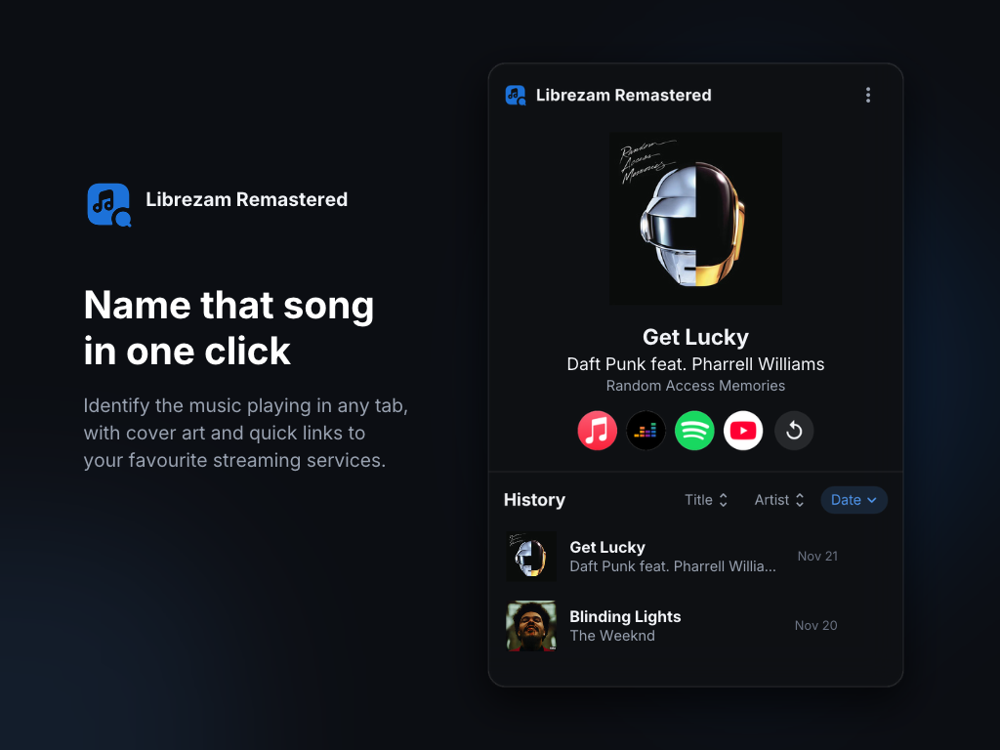

  
  <h1 align="center">Librezam Remastered</h1>
  
Song recognition webextension using Shazam API — with a redesigned interface

> **Librezam Remastered is a fork of [Librezam](https://github.com/FoxRefire/Librezam) by [FoxRefire](https://github.com/FoxRefire).**
> It is not affiliated with the original project or with Shazam/Apple, and is distributed under the same license (AGPL-3.0).
> To install the original extension, see the [Librezam repository](https://github.com/FoxRefire/Librezam).

## What's new in Remastered
- Redesigned popup: the Librezam logo as a big listen button, equalizer while listening, result card with cover art, compact history
- Redesigned settings pages, with custom dropdowns, slider, tooltips and dialogs (no default browser widgets)
- Missing or broken cover art is looked up via the iTunes Search API, with a dimmed-logo fallback
- Spotify links can open in the Spotify desktop app, falling back to the browser (setting under Streaming Providers)

### Notes
- The ACRCloud "Use default credentials" option relies on the original project's keys and does not work in this fork; use your own ACRCloud keys instead.
- When a cover is missing, the song's title and artist are sent to Apple's iTunes Search API to find one.

## What is it?
This is a browser extension that uses Shazam's internal API to recognize the music playing in the current tab.

Requests unrelated to music recognition, such as telemetry, will not be made.

This is unofficial project and is not affiliated or supported by *Shazam ltd.*

## Screenshot

## Third-party libraries/Referenced codes
* [Iconsax Bold Oval Icons](https://www.svgrepo.com/svg/495541/music-square-search)([MIT](https://www.svgrepo.com/page/licensing/#MIT)) //Extension Icon
* [node-shazam-api](https://github.com/asivery/node-shazam-api)([GPL-2.0](https://github.com/asivery/node-shazam-api/blob/master/LICENSE)) //Create Audio Signature & Querying Shazam API

  \*Included as [my fork](https://github.com/FoxRefire/node-shazam-api/tree/webpack) with webpack support and some improvements.
* [Song-identifier](https://gitlab.com/losnappas/Song-identifier/-/blob/master/songid-react/src/record.js?ref_type=heads)([Unlicense](https://gitlab.com/losnappas/Song-identifier/-/blob/master/LICENSE?ref_type=heads)) //Algorithm of record audio from DOM Element
* [Materialize](https://github.com/materializecss/materialize)([MIT](https://github.com/materializecss/materialize/blob/main/LICENSE)) //App interface
* [Material Symbols & Icons](https://fonts.google.com/icons)([SIL Open Font License](https://openfontlicense.org/)) // App interface
* Apple Music icon source: [Apple Music Identity Guidelines](https://marketing.services.apple/apple-music-identity-guidelines)
* YouTube icon source: [YouTube Brand Resources](https://brand.youtube/youtube-icon/)
* Google icon source: [Google Partner Marketing Hub — Branding Guidelines](https://partnermarketinghub.withgoogle.com/brands/google/branding-guidelines/how-to-show-googles-brand/)
